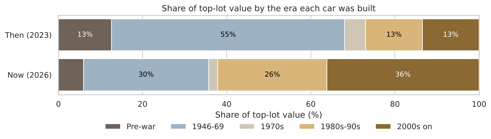
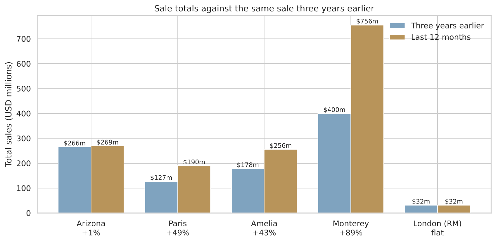
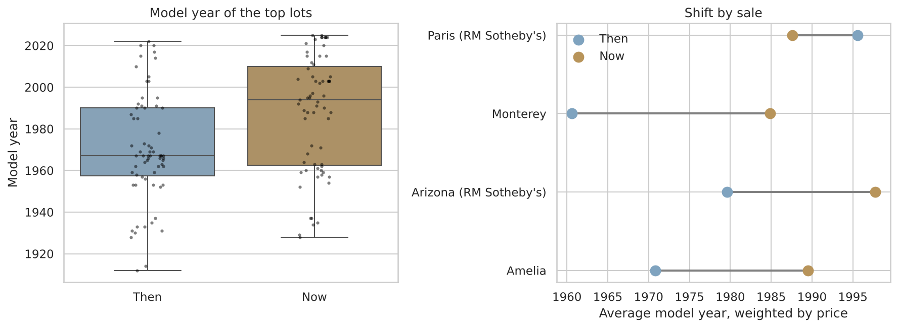
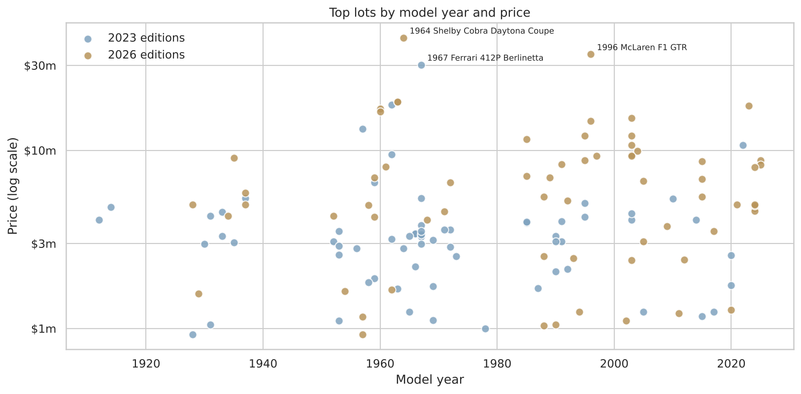

# Is the collector car market getting younger?

A data analysis of the key collector car auctions in the US and Europe, comparing the most valuable cars sold in the last 12 months with the same sales three years earlier.



## Key findings

- **The top lot is 27 years younger.** The median model year of the 67 most valuable lots moved from **1967** (2023 editions) to **1994** (2026 editions). The 95% bootstrap interval for the shift is 19 to 36 years.
- **The money has moved to younger cars.** Cars built since 1980 took **27%** of top-lot value three years ago and **62%** now. Cars built before 1970 fell from 68% to 36%.
- **The difference is significant.** Mann-Whitney U on model year: p < 0.001. Chi-square of era against edition: p = 0.002, Cramér's V = 0.36.
- **The high end grew fastest.** Monterey went from $400m to $756m, Paris rose 49% and Amelia 43%. Arizona and RM Sotheby's London were flat.



## Data

| Sale | Last 12 months | Three years earlier | Lots used |
|---|---|---|---|
| Monterey Car Week (five houses) | August 2026 | August 2023 | Top 30 |
| Amelia Island | March 2026 | March 2023 | Top 10 |
| RM Sotheby's Arizona | January 2026 | January 2023 | Cars over about $1m |
| RM Sotheby's Paris | January 2026 | February 2023 | Top 15 |

Collected by hand from public results: auction-house press releases, Hagerty's auction reports, classic-car-auctions.info and classic.com. Prices include buyer's premium.

## Notebooks

| Notebook | What it does |
|---|---|
| [01_data_collection](notebooks/01_data_collection.ipynb) | Sources, loading and checking the raw data |
| [02_cleaning_and_features](notebooks/02_cleaning_and_features.ipynb) | A like-for-like sample (67 lots each edition), eras and price features |
| [03_eda](notebooks/03_eda.ipynb) | Sale totals, value by era, model year shift, year against price |
| [04_hypothesis_testing](notebooks/04_hypothesis_testing.ipynb) | Mann-Whitney U, chi-square with Cramér's V, bootstrap intervals |





## Limitations

- Top lots only, not every car sold, so it says nothing about the mid-market.
- Hand-collected public data; sources count slightly differently.
- Four sales and two editions cannot separate a lasting trend from the mix of cars consigned in a given year.
- Paris runs against the trend on value share: its 2023 sale was led by a new $10.7m Bugatti.
- Goodwood is not compared (no comparable 2026 results published), nor is Broad Arrow Zürich (first held in 2025).

## Running it

```
pip install -r requirements.txt
cd notebooks
jupyter notebook
```

Run the notebooks in order: 02 writes the processed files that 03 and 04 read.

## Tools

Python, pandas, NumPy, SciPy, Matplotlib, seaborn, Jupyter.

## Repository structure

```
data/
  raw/          top_lots.csv, sale_totals.csv
  processed/    cleaned outputs from notebook 02
images/         figures saved by the notebooks
notebooks/      01 to 04
```
